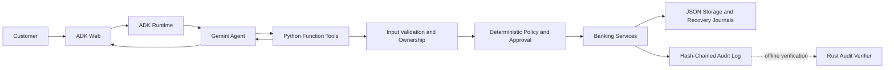
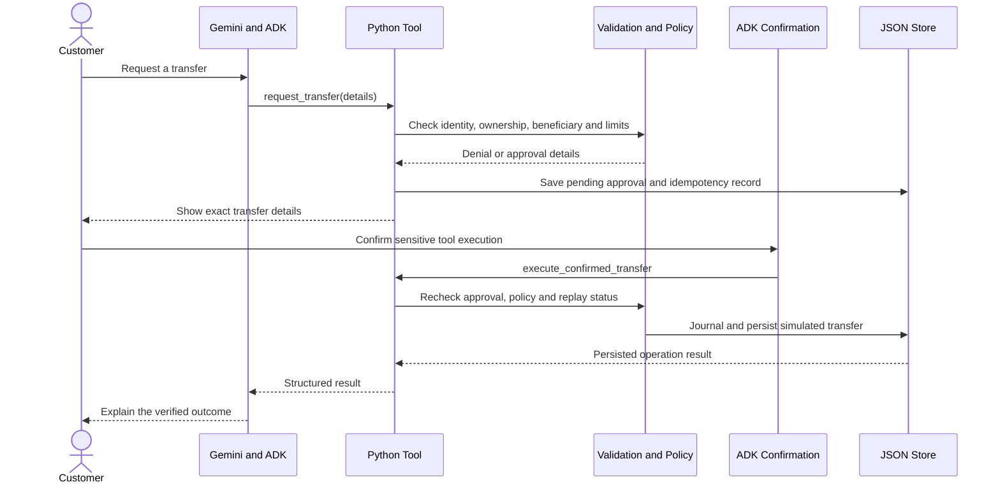
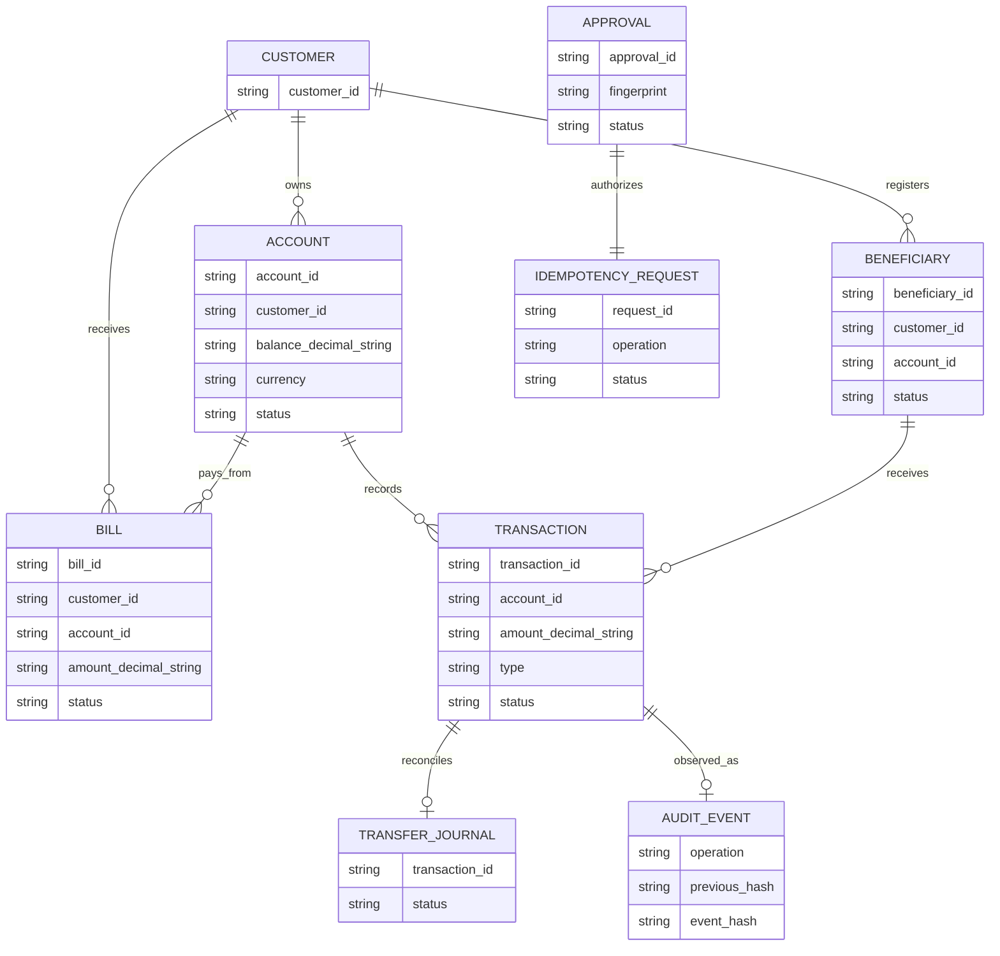

# BankGuard

BankGuard is a simulated banking assistant built to demonstrate how to place deterministic controls around an AI agent. The model interprets a request and selects a tool; application code validates identity, ownership, policy and approval before any sensitive operation can execute.

All accounts, customers and transactions in this repository are fictional. The application does not connect to a bank, move real money or provide financial advice. It is a learning and portfolio project, not production banking software.

## Project overview

BankGuard combines:

- Python 3.11+ and Google Agent Development Kit (ADK) for the agent, tools and application harness.
- Gemini for natural-language interpretation. Live model use is optional for local tests.
- JSON files for fictional demo data and application persistence.
- Rust for an independent command-line verifier of the Python audit log's hash chain.
- Pytest and GitHub Actions for automated checks.

The guiding rule is: **the model may propose an action, but deterministic application code decides whether it is allowed and whether it succeeded.**

## Architecture



The model does not read or write the data files directly. Sensitive actions use a request-then-execute flow: the application validates the request and creates an approval; ADK asks the user to confirm the execution call; the service rechecks the approval and business rules before committing the simulated operation.

### Transfer flow



## Capabilities

| Area | Included behavior |
|---|---|
| Account and transaction reads | Read owned accounts, balances, transaction history and search results |
| Beneficiaries | List and register eligible fictional accounts; prevent duplicate registration |
| Transfers | Check policy and ownership, request approval, confirm execution and record paired transactions |
| Bill payments | Bind approval to a specific pending bill and its owned source account |
| Deterministic controls | Validate arguments, use a configured demo identity, enforce policy and recheck approval details |
| Persistence | Use JSON files with locks, atomic replacement, backups and redo journals for supported operations |
| Audit integrity | Chain audit events with SHA-256; verify them offline with the Rust CLI |
| Tests and evaluation | Run local tests and mapped scenario evaluations without calling Gemini |

### Tool catalog

| Tool | Purpose | Effect |
|---|---|---|
| `get_balance` | Read an owned account balance | Read-only |
| `get_account`, `get_account_summary` | Read owned account information | Read-only |
| `get_transaction_history`, `search_transaction` | Read or filter owned-account transactions | Read-only |
| `list_beneficiaries` | List the active demo customer's beneficiaries | Read-only |
| `add_beneficiary` | Register an eligible fictional recipient | Requires ADK confirmation |
| `list_pending_bills`, `get_bill_details` | Read the active customer's bills | Read-only |
| `assess_transfer_risk` | Return deterministic risk indicators | Read-only |
| `request_transfer` | Validate a transfer and create a pending approval | Does not move money |
| `execute_confirmed_transfer` | Revalidate and execute the simulated transfer | Requires ADK confirmation |
| `request_bill_payment` | Create approval for an exact pending bill | Does not move money |
| `execute_confirmed_bill_payment` | Revalidate and pay the simulated bill | Requires ADK confirmation |

## Get started

### Requirements

- Python 3.11 or newer
- A Google Gemini API key only for live agent interaction
- Rust stable and Cargo only for the optional Rust verifier

The commands below assume macOS or Linux and a clone of this repository.

### Install Python dependencies

```bash
git clone https://github.com/MustakimShaikh01/Harness-Demo.git
cd Harness-Demo
python3.11 -m venv .venv
source .venv/bin/activate
python -m pip install -r requirements.txt
cp .env.example .env
```

Open `.env` in a local editor and set `GOOGLE_API_KEY` if you want to use the live Gemini agent. Keep that key private; do not commit `.env` or paste the key into source code, screenshots or issue reports. Without a key, you can still run the local test and evaluation suites.

The default model is `gemini-flash-lite-latest` to keep demo inference cost-conscious. Model availability depends on the API key and provider; `BANKGUARD_MODEL` can select another model supported by your account. Live model requests can incur charges.

### Initialize demo data

```bash
python scripts/seed_demo_data.py
```

This resets the demo JSON data to the fictional seed state and overwrites demo activity. Skip it if you want to preserve your existing local demo data.

### Start the agent

From the repository root, with the virtual environment active:

```bash
adk web --no_use_local_storage .
```

Open the local address printed by ADK and select the `banking_agent` application. Conversation state is held in memory and is lost when the server stops.

Try these prompts:

```text
Show my balance for acct_demo_001
Summarize acct_demo_001
Find transaction tx_seed_001 in acct_demo_001
Show my pending bills
Request a transfer of INR 500 from acct_demo_001 to ben_demo_001
```

For beneficiary registration, transfers and bill payments, review the details and use the ADK confirmation action when prompted. A conversational reply such as “yes” does not replace the confirmation step.

## Demo records

The default simulated customer is `cust_demo_001`, selected by trusted application configuration. This is a demo identity, not user authentication.

| Record | Identifier | Seed details |
|---|---|---|
| Savings account | `acct_demo_001` | INR 100,000.00 |
| Checking account | `acct_demo_002` | INR 25,000.00 |
| Other customer's account | `acct_demo_003` | Used to demonstrate access denial |
| Additional recipient account | `acct_demo_004` | Used to demonstrate beneficiary registration |
| Beneficiary | `ben_demo_001` | Family Savings, linked to `acct_demo_002` |
| Pending bill | `bill_demo_001` | Metro Electric, INR 1,850.00, paid from `acct_demo_001` |

## Run checks

The Python tests and evaluation scenarios use local fixtures and do not call Gemini:

```bash
pytest -q
python banking_agent/evaluation/evaluation_runner.py
```

Run the optional Rust verifier checks from the repository root:

```bash
cargo fmt --manifest-path rust/audit-verifier/Cargo.toml -- --check
cargo clippy --locked --manifest-path rust/audit-verifier/Cargo.toml --all-targets -- -D warnings
cargo test --locked --manifest-path rust/audit-verifier/Cargo.toml
```

To make a single optional live model request, configure `GOOGLE_API_KEY` and run:

```bash
python scripts/smoke_agent.py
```

This smoke test sends a billable request. It is separate from the local test suite.

## Rust audit verifier

The Python audit logger links each event to the previous event using SHA-256. The Rust CLI independently verifies a log without changing it:

```bash
cargo run --manifest-path rust/audit-verifier/Cargo.toml -- verify banking_agent/data/audit_logs.json
```

On success, the command prints the verified event count and current `head_hash`. A new or reset demo log may contain zero events; that is a valid empty chain.

The optional `--expected-head` argument compares the log with a 64-character hash checkpoint saved separately from a trusted earlier run. It can detect that the log was truncated at the end if the checkpoint was preserved. The verifier does not create or protect the checkpoint; an expected hash must be a real hash, not example text. See [audit and observability](docs/OBSERVABILITY.md) for details.

The Rust and Python implementations share test fixtures. For consistent hashes, audit events support strings, booleans, nulls, arrays, objects and safe integers. Floating-point values and integers outside the safe cross-language range are rejected; monetary values should be represented as decimal strings.

## Configuration

| Variable | Default | Description |
|---|---|---|
| `GOOGLE_API_KEY` | Unset | Gemini API key; needed only for live model calls |
| `BANKGUARD_MODEL` | `gemini-flash-lite-latest` | Gemini model name |
| `BANKGUARD_ENV` | `development` | Demo environment label |
| `BANKGUARD_DATA_DIR` | `banking_agent/data` | Directory containing JSON persistence |
| `BANKGUARD_DEMO_CUSTOMER` | `cust_demo_001` | Trusted simulated customer identity |
| `BANKGUARD_LOG_LEVEL` | `INFO` | Application log level |
| `BANKGUARD_MAX_OUTPUT_TOKENS` | `384` | Model output cap; accepted range is 64 to 2048 |

Transfer policy is configured in `banking_agent/config/policies.yaml`.

## Data model



## Repository layout

```text
banking_agent/
  agent.py                 ADK agent setup and tool registration
  config/                  Application settings and transfer policy
  prompts/                 Agent instructions
  tools/                   ADK function tools
  harness/                 Validation, approvals, policy and audit integrity
  services/                Deterministic banking operations
  storage/                 JSON store, repositories and recovery
  data/                    Fictional seed and local runtime data
  evaluation/              Scenario catalog and evaluation runner
rust/
  audit-verifier/           Standalone Rust audit-chain CLI
docs/                       Architecture, security, data and demo guides
scripts/                    Seed, recovery, checks and live smoke test
tests/                      Unit, integration, security and evaluation tests
```

## Security and project limitations

- Customer scope comes from application configuration, not from model-supplied tool arguments.
- Sensitive tools use ADK confirmation and then recheck ownership, policy, balance, approval details and replay status.
- Money calculations use `Decimal`; JSON values for amounts are decimal strings.
- JSON persistence includes locks, atomic file replacement and backups. Redo journals help recover supported interrupted operations, but JSON files are not a transactional database.
- Hash chains detect changed events when verified, but a person who can rewrite the complete file can recalculate the chain. Stronger tamper evidence requires a checkpoint, signature or log anchor protected separately.
- The project has no production login, MFA, real beneficiary verification, bank API, real payment settlement, multi-host database, HSM or compliance controls.
- The configured demo identity is not authentication. Anyone with access to the local UI can act as that simulated customer.

Do not use this project with real banking or personal data.

## Documentation

- [Architecture and control flow](docs/ARCHITECTURE.md)
- [Data model and persistence](docs/DATA_MODEL.md)
- [Audit and observability](docs/OBSERVABILITY.md)
- [Security assumptions and limitations](docs/SECURITY.md)
- [Harness engineering](docs/HARNESS_ENGINEERING.md)
- [Testing and evaluations](docs/TESTING.md)
- [10-minute demonstration guide](docs/DEMO_GUIDE.md)
- [Contributing](CONTRIBUTING.md)
