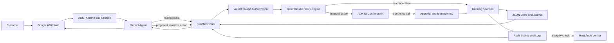
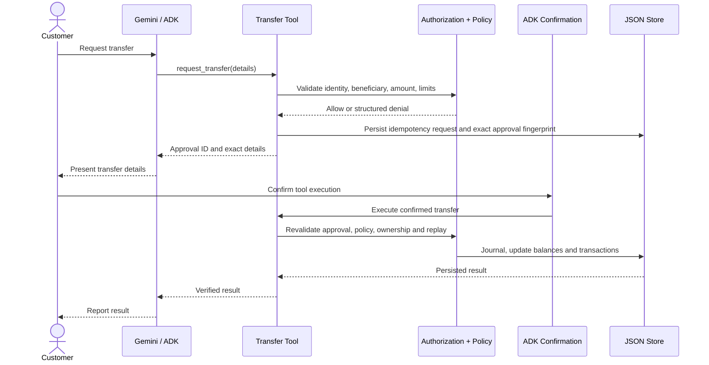
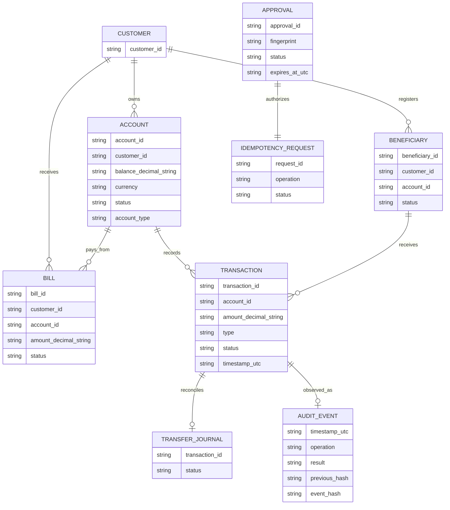

# BankGuard — AI Banking Agent Harness

> A portfolio project demonstrating how to put deterministic controls around an LLM agent. The model interprets requests; Python tools enforce ownership, policy and approval before any simulated financial operation.


**All accounts and banking activity are fictional. No real money is moved.** This project is for learning and demonstration, not production banking or financial advice.

## What it demonstrates

- Google ADK `LlmAgent` with Gemini and function tools.
- Practical read tools for accounts, balances, transaction history/search, beneficiaries and bills.
- Beneficiary registration with account validation and duplicate prevention.
- Sensitive operations split into request and execution stages.
- ADK Web confirmation prompts on transfer and bill-payment execution calls.
- Independent Python authorization, validation and policy checks.
- Decimal-based INR calculations, idempotency records, JSON persistence and audit events.
- A small Rust CLI that independently verifies the Python audit log's SHA-256 hash chain.
- Local unit, integration and security tests that do not call Gemini.

## Architecture



The model never opens or writes JSON files. A successful tool result—not model text—is the evidence for an operation's outcome. UI confirmation is an additional harness gate; services still recheck ownership, limits, balance, approval details and replay status.

### Transfer sequence



### Data model



See [architecture and persistence notes](docs/ARCHITECTURE.md) and [JSON data model](docs/DATA_MODEL.md) for field-level details.

## Tool catalog

| Tool | Purpose | Access |
|---|---|---|
| `get_balance` | Read available balance | Read-only |
| `get_account` / `get_account_summary` | Read owned-account details | Read-only |
| `get_transaction_history` / `search_transaction` | Read/filter owned-account activity | Read-only |
| `list_beneficiaries` | List active customer's registered beneficiaries | Read-only |
| `add_beneficiary` | Register an active demo account and prevent duplicates | Sensitive; ADK confirmation |
| `list_pending_bills` / `get_bill_details` | Read the active customer's bills | Read-only |
| `assess_transfer_risk` | Return deterministic risk indicators | Read-only |
| `request_transfer` | Validate request and create pending approval | No money moved |
| `execute_confirmed_transfer` | Execute after ADK UI confirmation and fresh checks | Sensitive |
| `request_bill_payment` | Create approval for exact pending bill details | No money moved |
| `execute_confirmed_bill_payment` | Pay from the bill's specified owned account after confirmation | Sensitive |

## Quick start

### 1. Requirements

- Python 3.11+
- A Google Gemini API key for live agent interaction
- macOS or Linux with Python 3.11+
- Rust stable/Cargo only if you want to build and run the optional audit verifier

### 2. Install

```bash
git clone <your-fork-or-repository-url>
cd bankguard
python3.11 -m venv .venv
source .venv/bin/activate          # Windows: .venv\Scripts\activate
python -m pip install -r requirements.txt
cp .env.example .env               # Windows PowerShell: Copy-Item .env.example .env
```

Edit `.env` locally and set `GOOGLE_API_KEY`. **Never commit `.env` or paste its key into README, screenshots, issue trackers, or source files.** The default model is `gemini-flash-lite-latest` to keep demo inference inexpensive; set `BANKGUARD_MODEL` to another model available to your API key if needed.

### 3. Seed fictional demo data

```bash
python scripts/seed_demo_data.py
```

The seed script resets the demo JSON files. Do not run it if you want to preserve demo activity.

### 4. Launch ADK Web

From the repository root:

```bash
adk web --no_use_local_storage .
```

Open the local URL printed by ADK and select the `banking_agent` app. Local ADK session context is in memory only and is lost when the server exits. Try:

- `Show my balance for acct_demo_001`
- `Summarize acct_demo_001`
- `Find transaction tx_seed_001 in acct_demo_001`
- `Show my pending bills`
- `Request a transfer of INR 500 from acct_demo_001 to ben_demo_001`

For transfers and bill payments, review and approve the ADK tool confirmation prompt. A conversational “yes” alone is not the execution confirmation.

## Demo identity and data

The default simulated customer is `cust_demo_001`, selected through trusted app configuration (`BANKGUARD_DEMO_CUSTOMER`).

| Demo record | ID | Details |
|---|---|---|
| Savings account | `acct_demo_001` | ₹100,000.00 |
| Checking account | `acct_demo_002` | ₹25,000.00 |
| Other demo customer account | `acct_demo_003` | Cross-customer access is denied |
| Additional recipient account | `acct_demo_004` | Use to demonstrate adding a beneficiary |
| Beneficiary | `ben_demo_001` | Family Savings, linked to `acct_demo_002` |
| Pending bill | `bill_demo_001` | Metro Electric, ₹1,850.00, pays from `acct_demo_001` |

This identity is a **demo boundary**, not login, authentication, MFA or production authorization.

## Cost-conscious testing

The evaluation runner executes the scenario-to-test mappings in `banking_agent/evaluation/test_cases.json` and reports individual outcomes. Local tests do not call the model or incur inference charges:

```bash
pytest -q
python banking_agent/evaluation/evaluation_runner.py
```

An optional live smoke test makes **one short Gemini request** and is billable:

```bash
python scripts/smoke_agent.py
```

The agent defaults to a Flash Lite model, low temperature, and a 384-token output cap. Local tests use service and storage fixtures instead of repeating paid LLM requests. If the provider returns 503, wait and retry or select another model available to your key.

## Configuration

| Variable | Default | Description |
|---|---|---|
| `GOOGLE_API_KEY` | unset | Gemini API key; required only for live model calls |
| `BANKGUARD_MODEL` | `gemini-flash-lite-latest` | Gemini model name |
| `BANKGUARD_ENV` | `development` | Demo environment label |
| `BANKGUARD_DATA_DIR` | `banking_agent/data` | Directory holding JSON persistence |
| `BANKGUARD_DEMO_CUSTOMER` | `cust_demo_001` | Trusted simulated identity |
| `BANKGUARD_LOG_LEVEL` | `INFO` | Application log level |
| `BANKGUARD_MAX_OUTPUT_TOKENS` | `384` | Model output cap (accepted range: 64–2048) |

Transfer policy lives in `banking_agent/config/policies.yaml`.

## Project layout

```text
bankguard/
├── banking_agent/
│   ├── agent.py                 # ADK agent, tool registration, token budget
│   ├── config/                  # Runtime settings and demo policy
│   ├── prompts/                # Concise agent behavior instructions
│   ├── tools/                   # ADK function tools
│   ├── harness/                 # Validation, approval, policy, audit
│   ├── services/                # Banking business logic
│   ├── storage/                 # Atomic JSON persistence and repositories
│   ├── data/                    # Fictional seed data and runtime JSON
│   └── evaluation/              # Deterministic scenario catalog/runner
├── docs/                        # Architecture, security, tests, demo guide
├── rust/audit-verifier/         # Optional Rust CLI for audit-chain verification
├── scripts/                     # Seed/reset, checks, optional live smoke test
└── tests/                       # Unit, integration, security and evaluation
```

## Trust and persistence limitations

- Tools obtain customer scope from application configuration, never from a model-supplied customer ID.
- ADK `FunctionTool(require_confirmation=True)` gates sensitive execution in the interactive ADK confirmation flow.
- Services revalidate the exact approval fingerprint, expiry, ownership, balance and policies before execution.
- Money uses `Decimal`; JSON encodes amounts as decimal strings.
- Writes use locks, temporary files, `fsync`, atomic replacement and a previous-file backup.
- Audit events are linked by SHA-256 hashes. Run `cargo run --manifest-path rust/audit-verifier/Cargo.toml -- verify banking_agent/data/audit_logs.json` to check the chain. For optional tail-truncation detection, pass a real, previously saved `--expected-head` hash; see [audit and observability](docs/OBSERVABILITY.md). A fully rewritten log is still not tamper-proof without an external signature or anchor.
- Transfer/bill journals store redo snapshots. After an interrupted operation, run `python scripts/recover_demo_data.py` to safely reapply approved prepared entries; this does **not** make JSON files a transactional database.
- Local JSON storage is for a single-user demo. It is not suitable for concurrent production workloads, multiple hosts, regulatory use or real financial data.

Read [security assumptions](docs/SECURITY.md) before demonstrating sensitive workflows.

## Documentation

- [Architecture and flow](docs/ARCHITECTURE.md)
- [Data model](docs/DATA_MODEL.md)
- [Audit and observability examples](docs/OBSERVABILITY.md)
- [Harness engineering](docs/HARNESS_ENGINEERING.md)
- [Threat model and demo limitations](docs/SECURITY.md)
- [Test and evaluation guide](docs/TESTING.md)
- [10-minute demo script](docs/DEMO_GUIDE.md)

## Roadmap / honest scope

This is a deliberately constrained simulated-banking harness. It does not implement production login, MFA, real beneficiary verification, multi-process database transactions, a live fraud model, an external bank API, or real bill settlement. Additions should preserve the “LLM proposes, deterministic harness decides” boundary.
