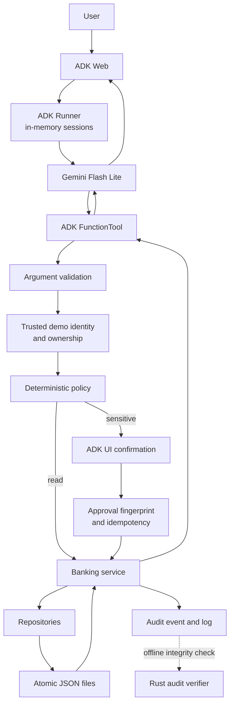

# Architecture and control flow

## System overview

The only inference service is Gemini. The agent asks for minimal information and has a token ceiling. Application business data is stored in JSON files. Launch ADK Web with `--no_use_local_storage` so ADK session state remains in memory rather than creating its default local SQLite session file. Conversation history is therefore lost when the process exits.

## Separation of responsibilities

| Layer | Responsibility | Must not do |
|---|---|---|
| Gemini agent | Interpret intent, select tools, explain verified outputs | Decide authorization, calculate policy outcomes, write data |
| ADK tools | Define callable input/output and request confirmation for execution | Trust user/model claims as approval |
| Harness | Validate, authorize, enforce policy, manage approval/idempotency and audit | Treat model reasoning as a security control |
| Services | Deterministic business rules and simulation | Access external banking/payment APIs |
| Repositories/JSON store | Locked, schema-shaped local file operations | Claim multi-file ACID guarantees |

## Read request

1. ADK forwards the conversation to the configured Gemini model.
2. The model selects a read-only function tool.
3. The tool validates the account/bill identifier.
4. The service uses the trusted customer identity to verify ownership.
5. The repository reads JSON data and returns a structured result.
6. The model summarizes only that result.

## Transfer workflow

1. `request_transfer` validates account ID, INR amount and request ID.
2. The service verifies source-account and beneficiary ownership.
3. The policy engine checks account state, amount and daily transfer limit.
4. An idempotency request and approval record are persisted. The approval fingerprint covers source, beneficiary, amount, currency and request ID.
5. `execute_confirmed_transfer` is wrapped in ADK `FunctionTool(require_confirmation=True)`. ADK Web asks the user to confirm this execution call.
6. On confirmation, the service checks the approval fingerprint, expiry, replay state, identity, current balance and policies again.
7. A write-ahead entry containing intended balances and paired transactions is prepared; data files are updated, idempotency/approval states finalized, and the journal marked committed.
8. The result and audit event are returned. The agent reports success only if the structured result says it completed.

If the user rejects the ADK confirmation, the tool body is not executed. Approval records are short-lived and cannot be replayed. A conversational “yes” does not replace the ADK confirmation action.

## Beneficiary registration

The `add_beneficiary` function is also wrapped by `FunctionTool(require_confirmation=True)`. After the ADK UI confirmation, the service validates the destination account, requires it to be active and outside the current customer's own accounts, and prevents duplicate registrations.

## Bill payment workflow

Bill details bind the payment to the customer's specific owned account. The request creates a fingerprint over bill ID, account, amount, currency and biller. The execution tool requires ADK confirmation and rechecks that the bill is still pending, the account is active, the account is owned by the demo customer and has enough balance. It records a debit transaction and a bill-payment journal entry.

## Persistence

`JsonStore` uses a per-file OS lock, temporary file, `fsync`, atomic replace and a previous-version backup. A separate application lock serializes transfer/bill workflows. Journals store the complete intended state before financial files change. If a process stops with a `prepared` entry, run `python scripts/recover_demo_data.py`: it validates approval and idempotency records, replays the exact intended snapshot (safe to repeat), consumes the approval, and marks the journal committed. This is redo recovery for the local demo, not general database transaction support.

For a demo, the JSON files are the business-data persistence layer. ADK Web is started with its local session persistence disabled; ADK conversation/session context is temporary in memory.

## Audit integrity verifier

The Python audit logger chains operation events with SHA-256 hashes. The standalone Rust CLI reads the JSON audit file and verifies each event hash and its link to the previous event; it is an offline integrity check, not part of request execution or a banking decision. See [audit and observability](OBSERVABILITY.md) for the command, canonicalization format and trust limitations. A local hash chain can be rewritten by someone who can replace the whole file, so it is not a tamper-proof compliance record.

## Session and identity boundary

`BANKGUARD_DEMO_CUSTOMER` configures the one active simulated customer. The model cannot select or override this identity through tool arguments. This is intentionally not authentication: any person with access to the local UI acts as the selected demo customer.

## Cost controls

- Default to `gemini-flash-lite-latest` (changeable through `BANKGUARD_MODEL`).
- Set low temperature and a configurable 384-token default response ceiling.
- Keep instructions short and ask the model to make only needed calls.
- Local test suites use no Gemini calls; `scripts/smoke_agent.py` makes one explicit live call.
- No automatic LLM retry loop is configured. Retry 503 responses manually after a short wait to avoid surprise repeated usage.
