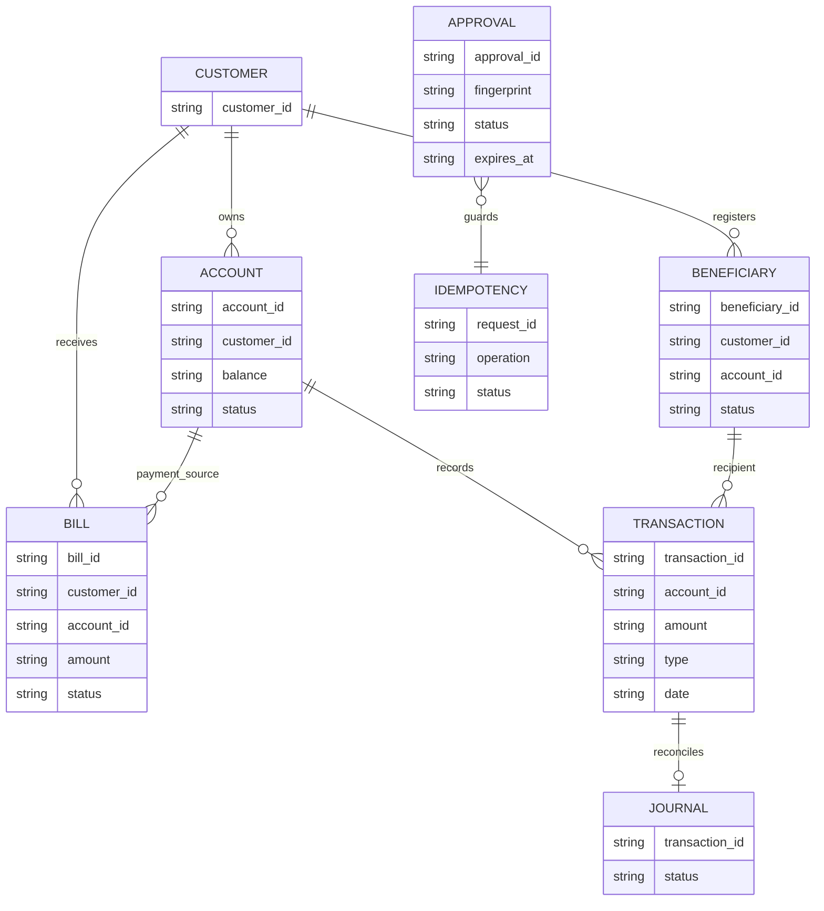

# JSON data model

The application has no application database. Each data file is a JSON array; money values are decimal strings, not binary floating-point numbers. Timestamps use UTC ISO-8601.

## Files and record shapes

| File | Purpose | Important fields |
|---|---|---|
| `accounts.json` | Fictional customer accounts | `account_id`, `customer_id`, `balance`, `currency`, `status`, `account_type` |
| `beneficiaries.json` | Customer-approved recipients | `beneficiary_id`, `customer_id`, `account_id`, `status`, `verified` |
| `transactions.json` | Simulated debits/credits | `transaction_id`, `account_id`, `amount`, `currency`, `type`, `date`, `status` |
| `bills.json` | Simulated bills | `bill_id`, `customer_id`, `account_id`, `amount`, `due_date`, `status` |
| `approvals.json` | Pending/consumed human approvals | `approval_id`, `transaction_request_id`, `fingerprint`, `status`, `expires_at` |
| `idempotency.json` | Financial request replay protection | `request_id`, `operation`, `status`, `result` |
| `audit_logs.json` | Structured operation events | `timestamp`, `request_id`, `tool`, `operation`, `execution_result` |
| `transfer_journal.json` | Transfer commit progress | `transaction_id`, `request_id`, `status`, `timestamp` |
| `bill_payment_journal.json` | Bill-payment commit progress | `transaction_id`, `bill_id`, `status`, `timestamp` |

## Relationships



IDs referenced by relationships are stored as fields, not enforced foreign keys. Services validate relevant records on each operation. Files are meant for fictional, local demo data only.

## Example approval

```json
{
  "approval_id": "generated-uuid",
  "transaction_request_id": "caller-request-id",
  "details": {
    "type": "transfer",
    "source_account_id": "acct_demo_001",
    "beneficiary_id": "ben_demo_001",
    "amount": "500.00",
    "currency": "INR",
    "request_id": "caller-request-id"
  },
  "fingerprint": "sha256-of-canonical-details",
  "status": "pending",
  "created_at": "UTC timestamp",
  "expires_at": "UTC timestamp"
}
```

The confirmation fingerprint is recomputed from canonical JSON. A modified amount, source account, beneficiary, currency or request ID does not match.
